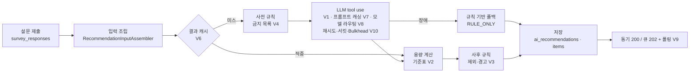

# AI 영양제 추천 - 단계별 개선 결과

> **먼저 읽을 것.** 이 문서의 숫자는 2026-10-21 밤새 실행 결과다. 실제 API 예산이 0달러라 **Claude API를 한 번도 부르지 않았다.**
> 그래서 품질·비용 지표(recall, 토큰, 요청당 비용 등)의 실제 값은 모두 "측정 안 함"이고, 표에 있는 품질 숫자는
> Fake LLM으로 돌린 **러너·파이프라인 동작 확인용**이다 (results.csv label에 `fake`). 실제 측정값은 ①LLM을 쓰지 않는 부분(용량 계산·규칙 단계 시간, 규칙 기반 폴백)과
> ②LLM을 WireMock(고정 지연 3초)으로 바꾼 in-JVM 부하·장애 테스트뿐이다. 실제 API 실행 명령은 [TODO-live-runs.md](TODO-live-runs.md).
>
> 숫자 옆 `{csv:step|label|열}`은 [results.csv](results.csv)의 출처 줄이다 (`#n` = 같은 label의 n번째 줄). `node docs/perf/verify-summary.js`로 대조한다.

## 한 줄 요약

- 알림 몰림(10초에 600건): 동기 구조는 3회 실행에서 에러율 0.2317 `{csv:09|V9-sync-spike-burst#1|error_rate}` · 0.0533 `{csv:09|V9-sync-spike-burst#2|error_rate}` · 0.0433 `{csv:09|V9-sync-spike-burst#3|error_rate}`, 큐 구조는 세 번 모두 0.0 `{csv:09|V9-queue-spike-burst#3|error_rate}` (WireMock 기준)
- 결과 캐시(V6): 같은 2,000건 부하에서 LLM 호출 2000 `{csv:08|V4-load-wiremock-2000|note:llm_calls}` → 809 `{csv:08|V6-load-wiremock-2000|note:llm_calls}`, TPS 15.1964 `{csv:08|V4-load-wiremock-2000|tps}` → 28.2315 `{csv:08|V6-load-wiremock-2000|tps}`
- 장애 대응(V10): LLM 60초 전면 장애에서 최종 성공률 0.5 `{csv:10|V9-queue-outage|note:success_with_fallback}` → 1.0 `{csv:10|V10-outage|note:success_with_fallback}` (그중 폴백 아닌 정상 응답 0.447 `{csv:10|V10-outage|note:success_without_fallback}`)

## 아키텍처

모든 LLM 호출은 `llm_call_logs`에 남는다 (토큰·지연·결과, 본문 저장 안 함). 단계별 지연은 Micrometer `recommendation.stage`.

## 버전별 결과

| 버전 | 바꾼 것 | 핵심 지표 Before → After | 리포트 |
| --- | --- | --- | --- |
| (설문) | 설문 API, 선택지 N+1 제거 | 설문 시작 SQL 20 → 7 (회원), p95 49.5 → 25.3 ms (H2·MockMvc) | [STEP02](STEP02-report.md) |
| V0 | JSON으로 답하라는 프롬프트만 | 실제 기준선 측정 안 함 | [STEP03](STEP03-report.md), [STEP04](STEP04-report.md) |
| V1 | tool use(strict 스키마) + 1회 재요청 | 실제 측정 안 함. Fake-noisy 재현성 실행 parse_fail 0.2 `{csv:04|V0-repro-fake-noisy|parse_fail_rate}` → 0.0 `{csv:05|V1-repro-fake-noisy|parse_fail_rate}` (메커니즘 확인) | [STEP05](STEP05-report.md) |
| V2 | 용량을 기준표로 계산 | 실제 측정 안 함. Fake-noisy dose_error 0.3571 `{csv:05|V1-repro-fake-noisy|dose_error_rate}` → 0.0 `{csv:06|V2-repro-fake-noisy|dose_error_rate}`. calc 단계 평균 0.3~0.6 ms (실측) | [STEP06](STEP06-report.md) |
| V3 | 사후 규칙 검증 | 실제 측정 안 함. Fake-noisy violation 0.26 `{csv:06|V2-repro-fake-noisy|violation_rate}` → 0.0 `{csv:07|V3-repro-fake-noisy|violation_rate}`, raw는 0.26 `{csv:07|V3-repro-fake-noisy|raw_violation_rate}` 그대로 | [STEP07](STEP07-report.md) |
| V4 | 사전 금지 목록 | 실제 측정 안 함. raw_violation 0.0 `{csv:07|V4-repro-fake-noisy|raw_violation_rate}`은 Fake 가정(금지 목록이 있으면 덜 틀림)에서 나온 값 | [STEP07](STEP07-report.md) |
| V6 | 결과 캐시 | 부하 LLM 호출 2000 → 809, TPS 15.1964 → 28.2315 (위). 평가셋 2회차 캐시 적중률 1.0 `{csv:08|V6-fake-pass2|cache_hit_rate}` | [STEP08](STEP08-report.md) |
| V7 | 프롬프트 캐싱 | 측정 안 함. 고정 부분 1,260자로 최소 캐시 길이(512토큰) 근처 → 실제 적용 여부 확인 필요 | [STEP08](STEP08-report.md) |
| V8 | 모델 라우팅 | 측정 안 함. 이 평가셋에서 32케이스 중 13케이스가 작은 모델로 라우팅 (입력만으로 정해지는 값) | [STEP08](STEP08-report.md) |
| V9 | 동기 / 가상 스레드 / 큐 | spike-burst 에러율·LLM 동시 호출: 아래 "트래픽·장애" | [STEP09](STEP09-report.md) |
| V10 | 재시도·서킷·Bulkhead·폴백 | flaky 성공률 0.8 `{csv:10|V9-queue-flaky|note:success_with_fallback}` → 1.0 `{csv:10|V10-flaky|note:success_with_fallback}`, slow p95 40592.8886 `{csv:10|V9-queue-slow|e2e_p95_ms}` → 45573.2411 `{csv:10|V10-slow|e2e_p95_ms}` ms (악화) | [STEP10](STEP10-report.md) |

## 품질

**실제 LLM 품질은 측정 안 함.** 아래는 같은 실수 패턴(시드 고정)을 내는 Fake-noisy LLM으로 각 단계가 의도대로 동작하는지 본 결과다. 모델의 실제 실수 비율과는 무관하다.

| 지표 (재현성 실행 10×5) | V0 | V1 | V2 | V3 | V4 |
| --- | --- | --- | --- | --- | --- |
| parse_fail_rate | 0.2 `{csv:04|V0-repro-fake-noisy|parse_fail_rate}` | 0.0 `{csv:05|V1-repro-fake-noisy|parse_fail_rate}` | 0.0 `{csv:06|V2-repro-fake-noisy|parse_fail_rate}` | 0.0 `{csv:07|V3-repro-fake-noisy|parse_fail_rate}` | 0.0 `{csv:07|V4-repro-fake-noisy|parse_fail_rate}` |
| violation_rate (최종) | 0.24 `{csv:04|V0-repro-fake-noisy|violation_rate}` | 0.26 `{csv:05|V1-repro-fake-noisy|violation_rate}` | 0.26 `{csv:06|V2-repro-fake-noisy|violation_rate}` | 0.0 `{csv:07|V3-repro-fake-noisy|violation_rate}` | 0.0 `{csv:07|V4-repro-fake-noisy|violation_rate}` |
| raw_violation_rate | 0.24 `{csv:04|V0-repro-fake-noisy|raw_violation_rate}` | 0.26 `{csv:05|V1-repro-fake-noisy|raw_violation_rate}` | 0.26 `{csv:06|V2-repro-fake-noisy|raw_violation_rate}` | 0.26 `{csv:07|V3-repro-fake-noisy|raw_violation_rate}` | 0.0 `{csv:07|V4-repro-fake-noisy|raw_violation_rate}` |
| dose_error_rate | 0.28 `{csv:04|V0-repro-fake-noisy|dose_error_rate}` | 0.3571 `{csv:05|V1-repro-fake-noisy|dose_error_rate}` | 0.0 `{csv:06|V2-repro-fake-noisy|dose_error_rate}` | 0.0 `{csv:07|V3-repro-fake-noisy|dose_error_rate}` | 0.0 `{csv:07|V4-repro-fake-noisy|dose_error_rate}` |
| reproducibility_dose | 0.48 `{csv:04|V0-repro-fake-noisy|reproducibility_dose}` | 0.54 `{csv:05|V1-repro-fake-noisy|reproducibility_dose}` | 0.6 `{csv:06|V2-repro-fake-noisy|reproducibility_dose}` | 0.74 `{csv:07|V3-repro-fake-noisy|reproducibility_dose}` | 0.74 `{csv:07|V4-repro-fake-noisy|reproducibility_dose}` |

- V0의 violation이 V1보다 낮아 보이는 것은 파싱 실패 실행(빈 결과)이 위반 없음으로 계산되기 때문이다
- 규칙 기반 폴백(LLM 미사용, 실제 측정): violation 0.0 `{csv:10|RULE_ONLY|violation_rate}`, dose_error 0.0 `{csv:10|RULE_ONLY|dose_error_rate}`, recall 1.0 `{csv:10|RULE_ONLY|recall}`. 단 recall 1.0은 평가셋 mustInclude를 같은 규칙으로 정의했기 때문에 당연한 값이고, 규칙이 걸리지 않는 일반 케이스에는 아무것도 추천하지 않는다

## 비용·지연

| 지표 | 값 |
| --- | --- |
| 요청당 비용, 입력·출력·캐시 토큰 | **측정 안 함** (실제 API 미사용). 단가는 [pricing.md](pricing.md) (Opus 5.5 입력 $4 / 출력 $20, Haiku 5.5 $0.10 / $0.50 per MTok, 2026-10-21 확인) |
| llm_p50 / llm_p95 | 측정 안 함 |
| 용량 계산·규칙 단계 시간 (실측, 로컬 JVM) | calc 평균 0.3~0.6 ms, rule_pre·rule_post 평균 1 ms 미만 ([STEP06](STEP06-report.md), [STEP07](STEP07-report.md)) |
| 결과 캐시 부하 (WireMock 3초, 2,000건) | 추천 p50 3,086 → 45 ms ([STEP08](STEP08-report.md)), p95 3611.4356 `{csv:08|V4-load-wiremock-2000|e2e_p95_ms}` → 4464.2709 `{csv:08|V6-load-wiremock-2000|e2e_p95_ms}` ms (p95는 나빠짐) |

## 트래픽·장애

### 알림 몰림 (STEP 09, 10초에 600건, Tomcat 50스레드, 큐 워커 20, WireMock 3초)

| 구조 | 에러율 1회 / 2회 / 3회 | LLM 동시 호출 최대 (3회차) | 완료 p95 (3회차) |
| --- | --- | --- | --- |
| V9-sync | 0.2317 `{csv:09|V9-sync-spike-burst#1|error_rate}` / 0.0533 `{csv:09|V9-sync-spike-burst#2|error_rate}` / 0.0433 `{csv:09|V9-sync-spike-burst#3|error_rate}` | 50 `{csv:09|V9-sync-spike-burst#3|note:llm_concurrent_max}` | 28904.9975 `{csv:09|V9-sync-spike-burst#3|e2e_p95_ms}` ms |
| V9-vt | 0.0017 `{csv:09|V9-vt-spike-burst#1|error_rate}` / 0.0017 `{csv:09|V9-vt-spike-burst#2|error_rate}` / 0.1467 `{csv:09|V9-vt-spike-burst#3|error_rate}` | 314 `{csv:09|V9-vt-spike-burst#3|note:llm_concurrent_max}` | 28794.9712 `{csv:09|V9-vt-spike-burst#3|e2e_p95_ms}` ms |
| V9-queue | 0.0 `{csv:09|V9-queue-spike-burst#1|error_rate}` / 0.0 `{csv:09|V9-queue-spike-burst#2|error_rate}` / 0.0 `{csv:09|V9-queue-spike-burst#3|error_rate}` | 20 `{csv:09|V9-queue-spike-burst#3|note:llm_concurrent_max}` | 93507.1 `{csv:09|V9-queue-spike-burst#3|e2e_p95_ms}` ms |

- 큐만 세 번 모두 실패 0이고 LLM 동시 호출을 워커 수로 묶었다. 대신 완료까지 오래 걸린다 (워커 20 × 3초 = 초당 6.7건 상한)
- 가상 스레드는 3회차에 에러율이 크게 올랐고 LLM 동시 호출이 수백까지 올라간다 → 실제 API라면 rate limit에 걸린다
- 같은 600명을 60초에 흩으면(발송 분산) sync·vt 모두 실패 0 ([STEP09](STEP09-report.md)). 알림 진입 시 저장된 추천 재사용으로 LLM 호출 70% 감소 (프로필 변경 30% 가정)

### 장애 주입 (STEP 10, queue 모드 워커 20)

| 시나리오 | 지표 | V9-queue | V10 |
| --- | --- | --- | --- |
| flaky | 성공률 (폴백 포함) | 0.8 `{csv:10|V9-queue-flaky|note:success_with_fallback}` | 1.0 `{csv:10|V10-flaky|note:success_with_fallback}` |
| flaky | 재시도 호출 | - | 45 `{csv:10|V10-flaky|note:retry_calls}` |
| flaky | 429 응답 | 10 `{csv:10|V9-queue-flaky|note:http429}` | 12 `{csv:10|V10-flaky|note:http429}` |
| slow | 완료 p95 (ms) | 40592.8886 `{csv:10|V9-queue-slow|e2e_p95_ms}` | 45573.2411 `{csv:10|V10-slow|e2e_p95_ms}` |
| outage | 성공률 (폴백 포함 / 제외) | 0.5 `{csv:10|V9-queue-outage|note:success_with_fallback}` / 0.5 `{csv:10|V9-queue-outage|note:success_without_fallback}` | 1.0 `{csv:10|V10-outage|note:success_with_fallback}` / 0.447 `{csv:10|V10-outage|note:success_without_fallback}` |

- outage에서 서킷이 2.3초 만에 열리고, 장애 종료 7.2초 뒤 닫혔다 ([STEP10](STEP10-report.md))
- slow에서는 15초 타임아웃이 20초 느린 응답을 실패·재시도로 바꿔 p95가 나빠졌다. 타임아웃은 실제 지연을 잰 뒤 정해야 한다

## 측정 방법과 한계

| 항목 | 내용 |
| --- | --- |
| 평가셋 | 32케이스 (규칙 1개 12, 여러 개 10, 없음 5, 비회원 5), **검토 전 (`reviewed = false`)**. 기대값은 domain-rules.md 규칙·기준값에서만 도출, 원하는 효과 → mayInclude 매핑은 출처 없음 |
| 실제 API | 사용 안 함 (예산 0달러). 품질·비용 실측은 전부 대기 |
| DB | 테스트·측정은 H2 인메모리(MySQL 모드). 실제 MySQL 수치 없음 |
| 부하 | k6 미설치 → in-JVM 대체 측정. 부하 발생기·WireMock·서버가 같은 JVM·CPU를 써서 실행 간 편차가 크다 (같은 구성 3회 실행에서 에러율 0.0433~0.2317). 스레드 수 측정은 실패해 쓰지 않았다 |
| WireMock | LLM 응답을 고정 지연 3초 고정 응답으로 대체. 장애는 상태 순환 시나리오로 비율을 정확히 맞춤 |
| 단가 기준일 | 2026-10-21 (공식 가격표) |
| 테스트 설정 차이 | 테스트는 `open-in-view: false`. 운영 기본값(true)에서는 LLM 대기 중 DB 커넥션을 잡고 있을 수 있어 몰림 결과가 더 나쁠 수 있다 |

## 하지 않은 것과 이유

- **V5 (RAG)**: 처음 설계에서 뺐다. 추천 근거(기준값·규칙)가 수십 행이라 검색할 문서가 없고, 안전 판단은 규칙 테이블이 맡는다
- **실제 API 측정**: 예산 0달러. 명령은 [TODO-live-runs.md](TODO-live-runs.md)에 STEP 순서로 정리
- **Flyway·Testcontainers**: 팀 공통 설정(ddl-auto: update)을 바꾸지 않기 위해 쓰지 않았다. 스키마 변경은 `docs/sql/`에 DDL로 공유
- **notifications 유니크 제약·알림 테이블 쓰기**: 다른 담당 도메인이라 제안 SQL만 남겼다
- **캐시 스탬피드 방지(single-flight), 비회원 응답 가로채기 방지**: 범위 밖, 다음 과제
